

  <picture>
    <source media="(prefers-color-scheme: dark)" srcset="images/logo-dark.svg">
    
  </picture>

<h1 align="center">Thetas</h1>

<b>AI knows what to teach. We tell it who it's teaching.</b>

  <a href="https://thetas.ai">thetas.ai</a> (the app) ·
  <a href="https://thetasai.com">thetasai.com</a> (the company) ·
  <a href="https://thetas.ai/developers">thetas.ai/developers</a> (MCP docs)

---

AI tutors and chat assistants can explain almost anything, but they start every conversation without knowing what this student has actually shown they can do. A chat history is not a learning record, so the AI cannot tell which ideas a student can use on their own, which mistakes keep coming back, or what they should practise next.

Thetas keeps that record. A **learning brain** for each student is built from their own marked work and their tutor's lessons, and a **teaching brain** uses it to decide what comes next. Our app is the first place both are used, and any AI can read them over MCP.

We are a small team, and we built and run the whole system ourselves: the student app, the tutor side, the two brains and the MCP server, our admin portal and team workspace, a studio for lesson content, and our quotation and invoicing tools. The source is private. This page shows what each part does.

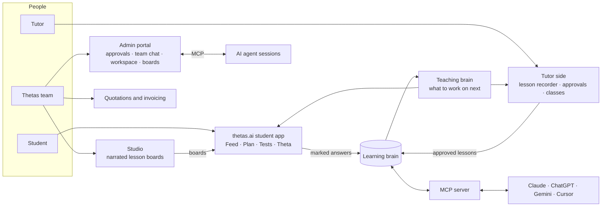

---

## thetas.ai: the student app

A private learning feed for each student. It decides what to practise today from their learning brain, carries their tutor's lesson notes and set work, and has Theta, an assistant that knows the student's plan and progress.

  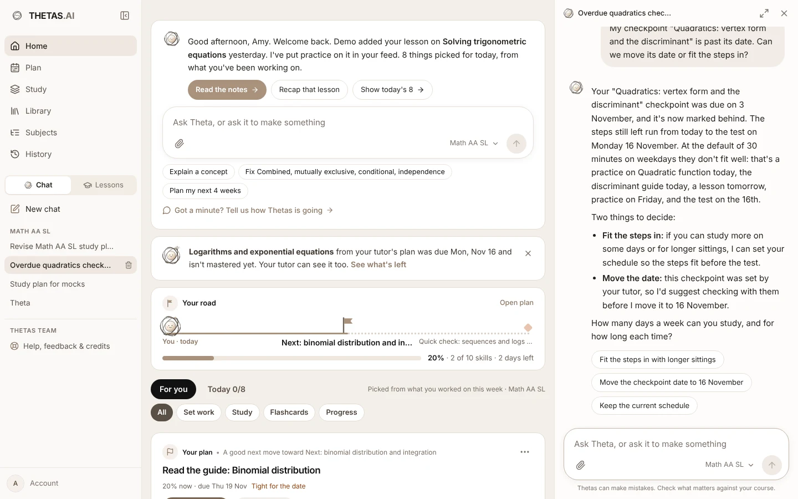
  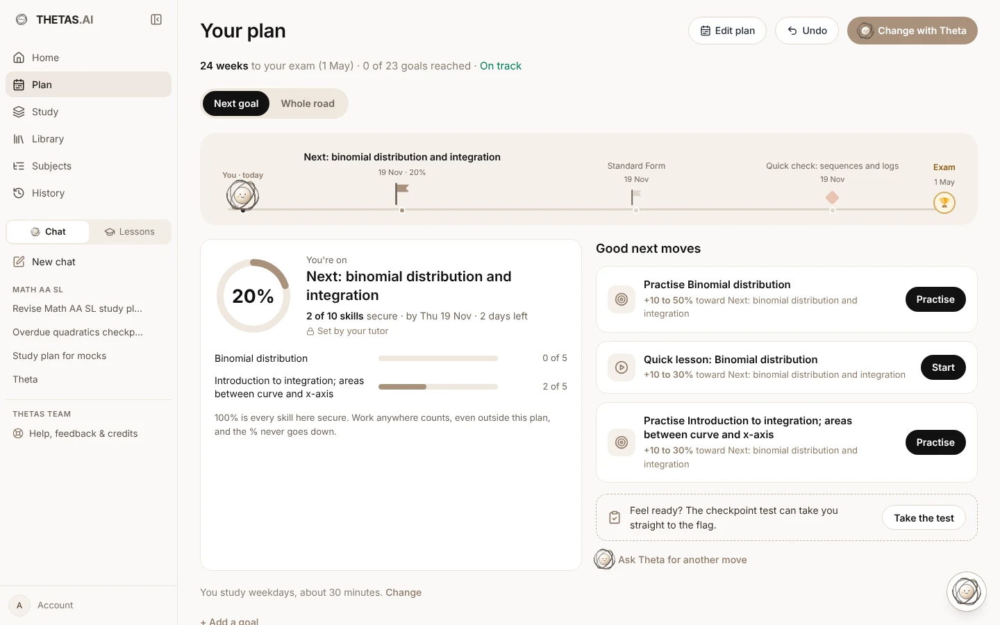

  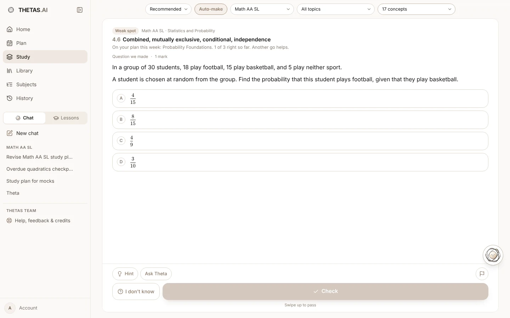

- **Feed**: one question at a time, picked from weak spots, set work and ideas that are about to fade. Hints, "I don't know", and Ask Theta on every question; answers are marked and go straight into the learning brain.
- **Study plan**: goals on a road to the exam date, set by the student or their tutor, with the next few moves that would get them to the next goal and a checkpoint test when they feel ready.
- **Tests**: tests set by a tutor or made for the student from the question bank, with results that feed the brain.
- **Theta**: an assistant in a side panel that answers questions, explains concepts, recaps lessons and changes the plan. Suggested replies are filled in for the student to send, never sent for them.
- Notes, flashcards and quick lessons for each concept, starting with IB Maths Analysis and Approaches (SL and HL).

## Tutor side

Built to cut a tutor's preparation and follow-up time. A tutor records a lesson (or pastes a transcript or notes), Thetas drafts what came out of it, and the tutor approves each part before anything reaches a student.

  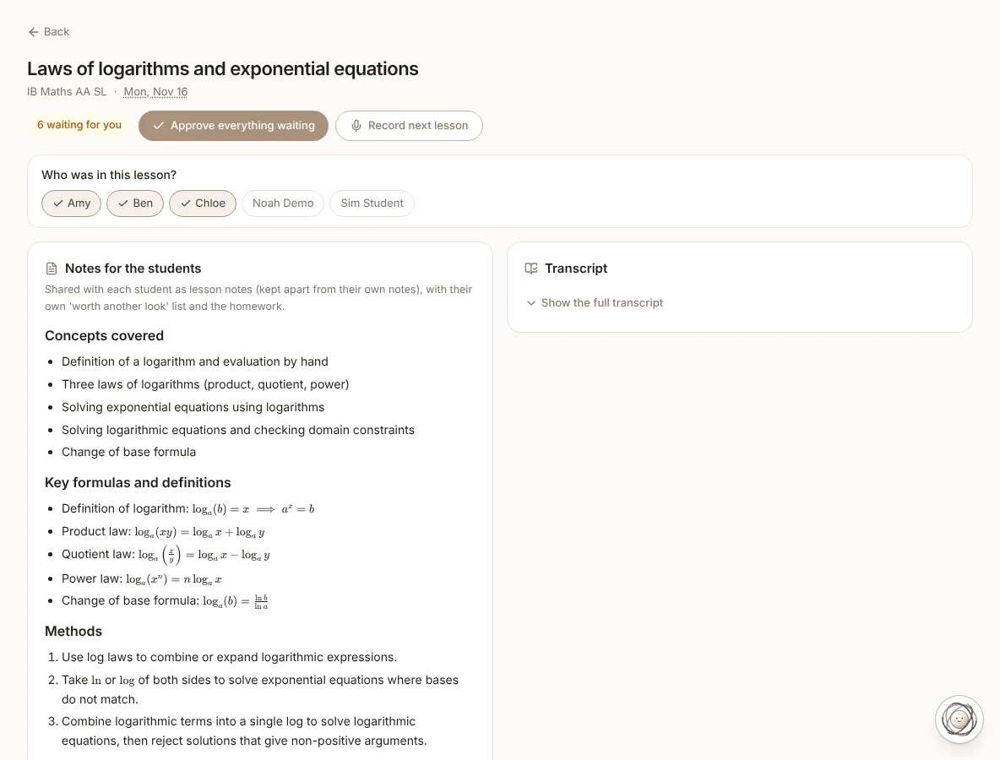
  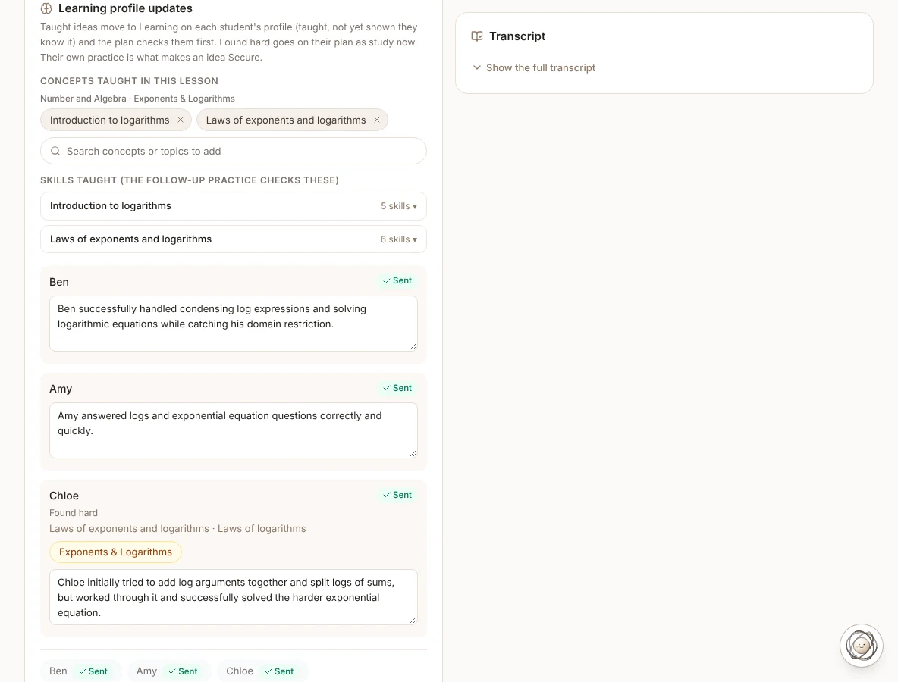

  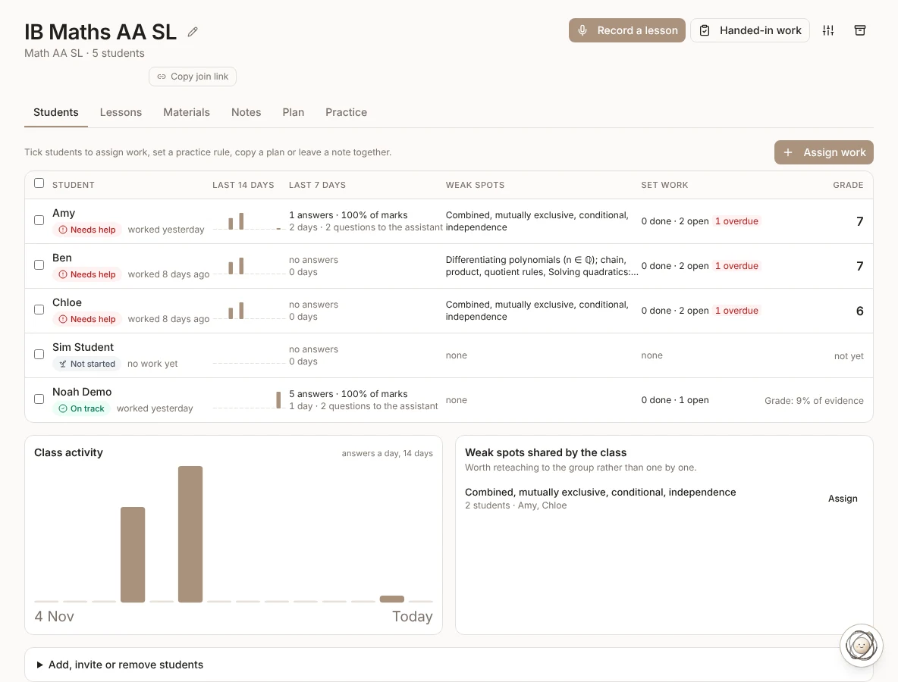

- **Lesson recorder**: record in the browser; the transcript becomes lesson notes, what each student found hard, the concepts and skills taught, and follow-up practice for each student.
- **Approvals**: notes, learning profile updates and practice are approved per part and per student ("Send notes for all 3", "Set practice for all 3"). Nothing goes to students without the tutor's yes.
- **Class view**: who is on track, who needs help or has gone quiet, shared weak spots worth reteaching to the group, set work and an estimated grade once there is enough evidence.
- Classes with join links, practice rules that set automatic practice from each student's weak spots, a test builder on the question bank, and calendar import from Google, Apple or Outlook.

## Learning brain and MCP server

The learning brain is a record of what one student has shown they can do, built from evidence the platform checked: answers marked, explanations given and checks passed over time. Nobody can type in that a student knows something. A concept moves through New, Learning, Almost there, Secure and Mastered, and is flagged for a refresh when it starts to fade. The teaching brain reads it to pick what comes next.

  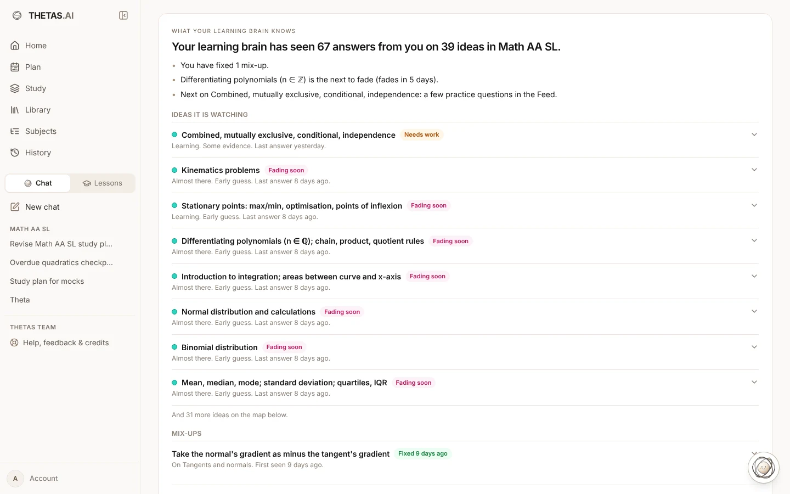
  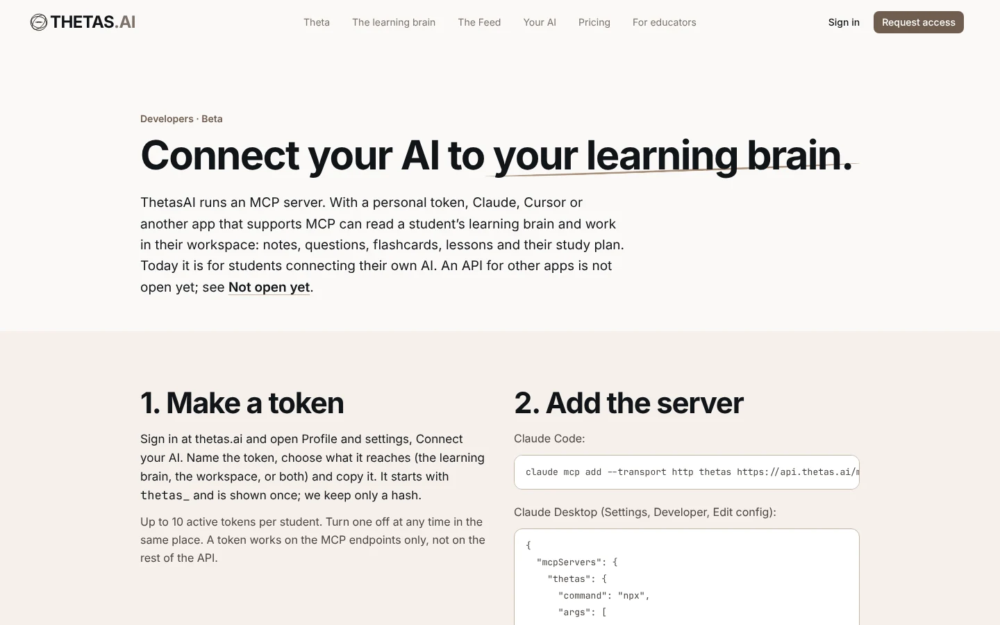

- Every answer, lesson and check is stored as an event first and placed on a course map later, so the brain is not tied to one curriculum.
- Tracks misconceptions ("mix-ups") as well as concepts, and when each idea is due for a check.
- **MCP server** with separate endpoints for the learning brain, the student's workspace (notes, questions, flashcards, lessons, study plan) and tutors (classes, students, tests, lessons, practice rules).
- Students make their own personal access tokens and choose what each one reaches; tutors connect their own AI to their classes. Works with Claude, ChatGPT, Gemini, Cursor and other MCP clients.
- The partner API for other apps is not open yet.

## Admin portal

How we run the company day to day, at admin.thetasai.cloud. People and AI agents work in the same place: an agent session connects over MCP or the REST API and reads and writes the same files and tasks we do.

  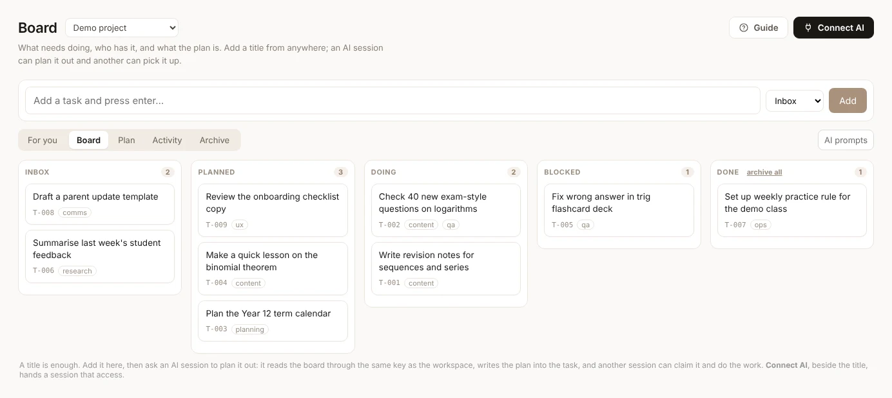
  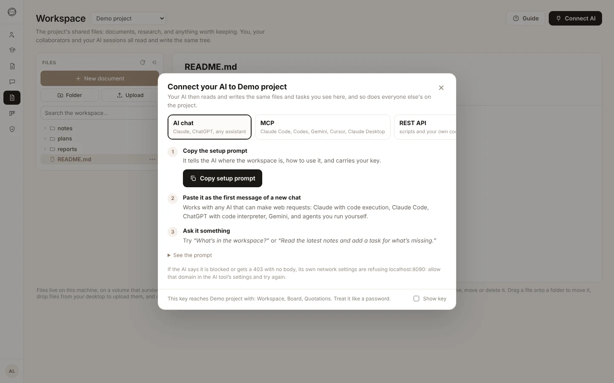

  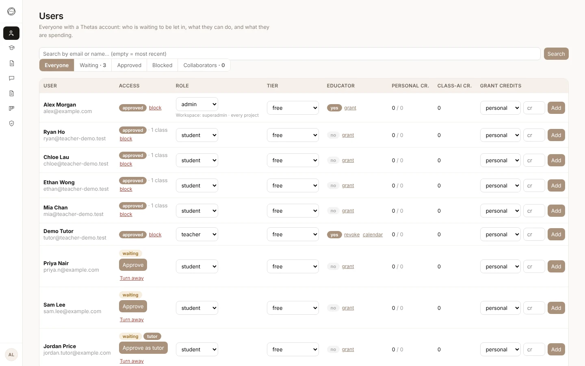
  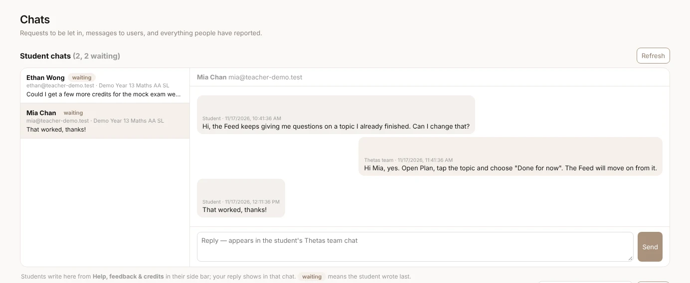

- **Approval flows**: new sign-ups wait to be let in; tutors are approved as tutors; access requests and contact messages are handled in one inbox.
- **Team chat**: students write to us from Help, feedback and credits in the app, and we reply from the portal. Reported questions from the Feed land here too.
- **Team workspace**: shared files per project, with version history, that we, invited collaborators and AI sessions all edit.
- **Boards that AI agents connect to**: tasks with full history and notes, a "For you" desk that shows what needs a person, decisions an agent asks us to make, and ready-made prompts so a session can pick up a task where the last one stopped.
- Projects, collaborators and per-person toolkits, with Google sign-in for collaborators.

## Studio

Thetas Studio makes narrated, animated lesson boards for maths: each board is a short explainer or worked example that builds up step by step on a whiteboard, with subtitles and a transcript. The boards are written for students and played inside thetas.ai; the Studio itself is an internal tool for our team.

  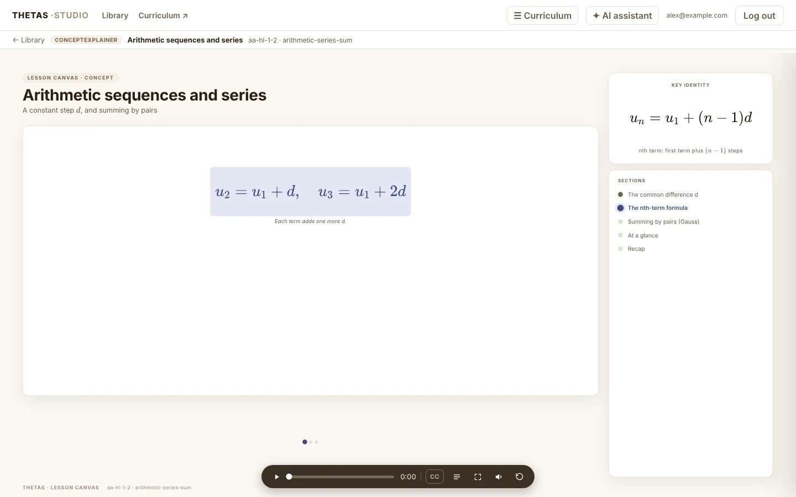
  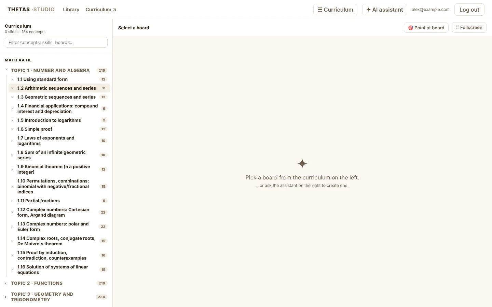

- About 1,100 boards for IB Maths Analysis and Approaches (mostly HL), organised by topic and concept.
- Boards are generated from HTML templates (Hyperframes, CSS and GSAP) with Claude filling the content, then reviewed and edited in the Studio.
- Narration audio is generated per board and synced beat by beat with the drawing.
- Built to work on a phone as well as on a desktop, in a lesson or on its own.

## Quotations and invoicing

Selling to tutoring centres means quoting a scope and sending invoices, so we built tools for both.

  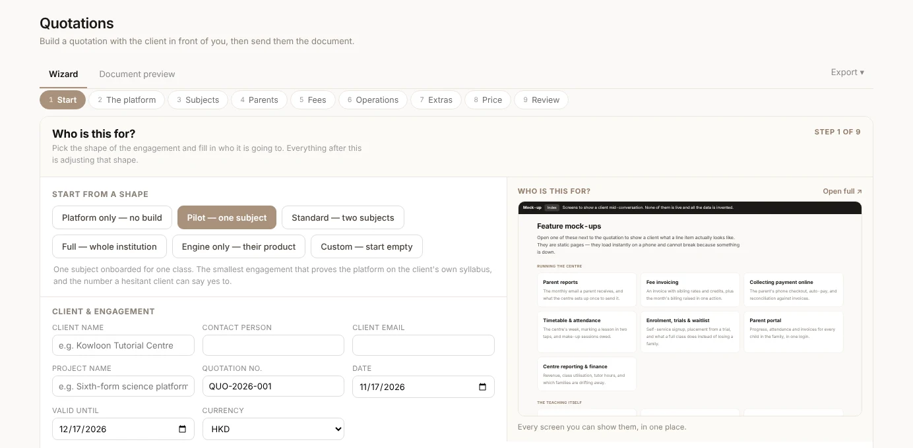
  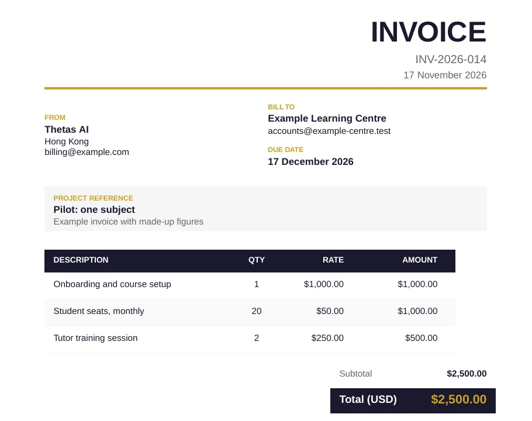

- **Quotation builder** in the admin portal: a guided wizard from the shape of the engagement to the price, with a live preview of the features being quoted, templates, and export.
- **Invoice generator**: invoices and quotations as PDFs, with saved templates and several currencies.
- The invoice generator also runs as an MCP server, so an AI assistant can draft an invoice from a conversation.

## Company site: thetasai.com

What the company is building and why: the learning brain, the teaching brain, and the study app that uses them, with links to the developer docs.

  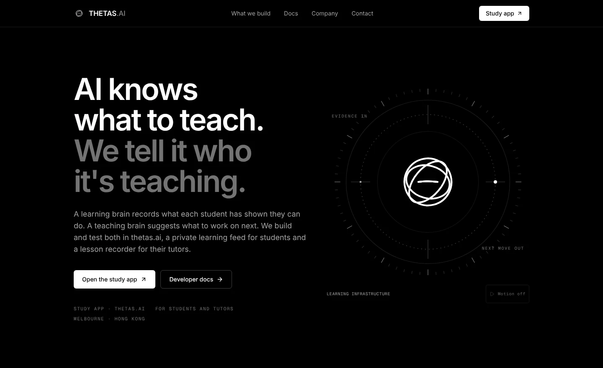
  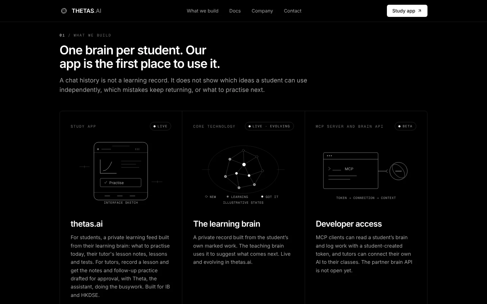

---

## Stack

| Part | Built with |
|---|---|
| Student app and tutor side | Next.js 15, React 19, TypeScript, Tailwind, KaTeX |
| API, learning brain, MCP server | Python, FastAPI, PostgreSQL with pgvector |
| AI | Gemini for chat, marking, transcription and embeddings; Claude for content and agent work |
| Admin portal and workspace | Node.js, Express, vanilla JavaScript, MCP server |
| Studio | TypeScript, Node.js, Hyperframes (HTML, CSS, GSAP), generated narration |
| Invoicing | Next.js, PDFKit, MCP server |
| Hosting | Render for the app and API; our own VPS with Dokploy for the portal, Studio and company site |

## How we got here

| When | What |
|---|---|
| 2025 | Tutor v1: our first tutoring workspace and an IB tutor prototype |
| Oct 2025 to Feb 2026 | TutSpace, an AI practice and question bank app |
| May 2026 | TutSpace migrated into a new codebase: thetas.ai |
| Since then | thetas.ai grows into the learning brain, the tutor side, the MCP server and the tools around them |

## Status

Closed beta, IB Maths, Hong Kong.

## Contact

[tobyll@thetasai.com](mailto:tobyll@thetasai.com)
